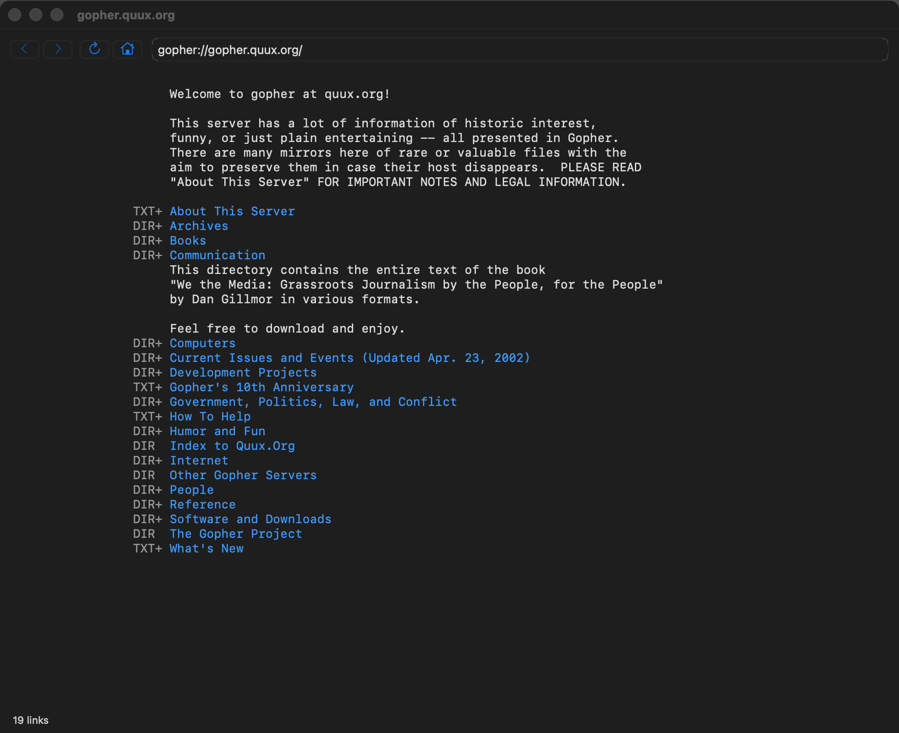
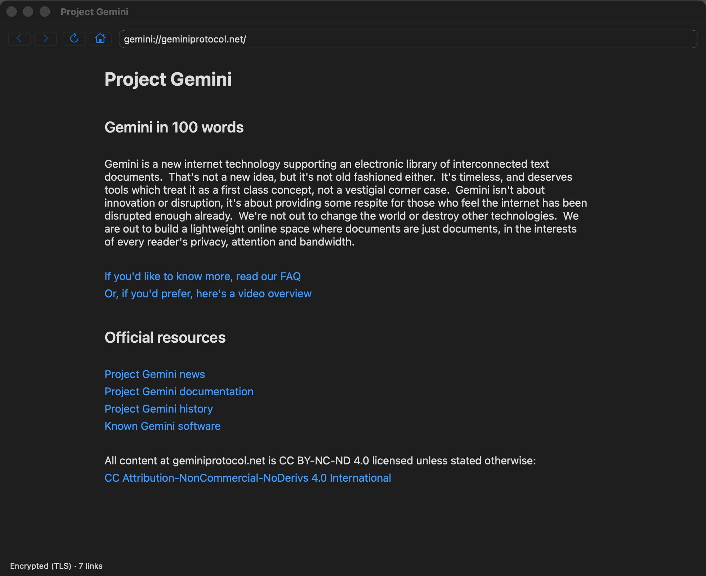
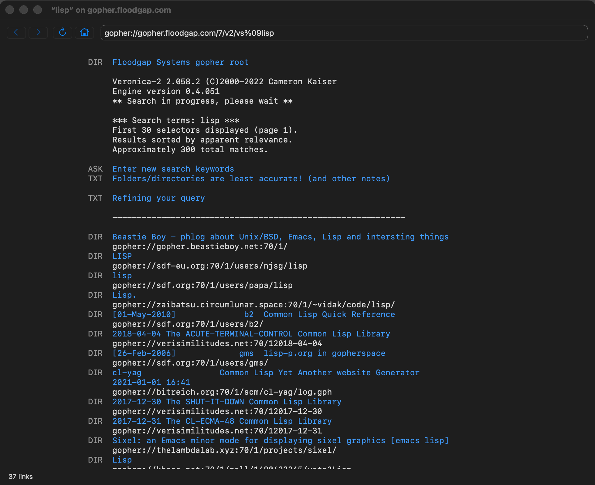

# Gopher

A macOS browser, written in Common Lisp, for Gopher and the small web around
it: Gopher and Gopher+, gophers (Gopher over TLS), Gemini, Spartan, Nex, Guppy
and Finger.

It is a window onto the [gopher](https://github.com/lispnik/gopher) library,
which does the protocols. It is built with SBCL,
[objc](https://github.com/lispnik/objc) for AppKit,
[asdf-macos-app](https://github.com/lispnik/asdf-macos-app) for the bundle,
FiveAM for the tests and ocicl for the dependencies.



## Screenshots

| | |
|---|---|
|  |  |
| A Gemini page: headings, prose in a column of reading width, links. The status line says it came over TLS. | A Veronica-2 search for *lisp*, kept at an address with the search in it, so Back and Reload repeat it. |

Above: quux.org's Gopher menu. The item types are in a column of their own,
`+` marking Gopher+ items, whose information and views are a right-click
away.

The screenshots are the browser's own: `GOPHER_BROWSER_SNAPSHOT` (see
*Checking the bundle from a script*) has it draw its window into a PNG.

## What it does

- **Menus and pages.** Gopher menus are drawn monospaced, each link after its
  item type (`DIR`, `TXT`, `ASK`, `IMG`, ...), so ASCII art lines up. Gemtext
  gets headings, lists, quotes and preformatted blocks. Pages are drawn as
  their lines arrive, in a centred column of comfortable width.
- **Tabs and windows.** ⌘T opens a tab, ⌘N a window; ⌘-click opens a link in
  a background tab. Back, Forward, Reload, Home and the address are the
  window's toolbar, with the tab bar under it. They are macOS's own tabs: the tab bar, Show All Tabs and
  Merge All Windows all work. The windows and tabs open when you quit come
  back when you start again, where they were.
- **Following links.** Click, or Tab and Shift-Tab to move from link to link
  and Return to follow. View › Show Link Numbers (⌘K) numbers them: type a
  number and Return. Pointing at a link shows its address in the status line.
  The mouse's back and forward buttons go back and forward, and so do
  two-finger swipes (fingers to the right is back, as in Safari).
- **The address bar** finishes addresses from the history and bookmarks as
  you type, from any part of them: `floodgap` finds `gopher.floodgap.com`. Words are searched for, with Kennedy, TLGS or Veronica-2 (Go ›
  Search Words With).
- **Searches and input.** Gopher search items, Gemini input requests (10, and
  11 with the typing hidden) and Spartan `=:` prompts ask in a dialog.
- **Images and downloads.** Images are shown in the window. Anything else is
  saved where you say, streamed to disk however large it is, and listed in
  Window › Downloads (⌥⌘L), where it can be stopped or shown in the Finder.
- **History.** The History menu lists recent pages; Show All History (⌘Y,
  `about:history`) lists them by day and searches them. Reopen Closed Tab
  (⇧⌘T) brings back what was closed. A search's results are kept at an
  address with the search in it, so Back and Reload repeat the search.
- **Bookmarks.** Add (⌘D), Show All (`about:bookmarks`), and Edit Bookmarks
  (⌥⌘B) to rename, readdress, reorder and delete them. A new browser starts
  with 28 suggested places in Gopherspace and Geminispace (and one each on
  Spartan, Nex and Finger); Bookmarks › Add Suggested Bookmarks puts back
  any that are missing.
- **Text size.** ⌘+, ⌘− and ⌘0, for every window, and remembered.
- **Gopher+.** Gopher+ items are marked `DIR+`, `TXT+`; items with a form,
  `TXT?`, ask its questions (text, passwords, several lines, choices, a file
  to send, a file to keep the reply in) before they are fetched. Right-click an item for Item Information: its abstract,
  administrator, and its views, each a link that fetches that view.
- **Titan.** File › Upload with Titan (⇧⌘U) sends text or a file to a
  `titan://` (or `gemini://`) address, with a token if the server wants one;
  Edit This Page with Titan (⇧⌘E) starts from the page on show, its text and
  its address.
- **Settings** (⌘,): the home page, the search engine for words typed in the
  address bar, link numbers, the timeout, a SOCKS5 proxy for every request
  (Tor, for example), and whether `gopher://` tries TLS first. It does unless told not to, and falls
  back to plain Gopher quickly, including from servers that accept TLS and
  then send nothing. Changing the proxy empties the cache, so no page fetched
  another way is shown as if it came through the proxy.
- **Page Info** (⌘I) says how the page came: protocol, status, type, size,
  whether it was encrypted, the certificate and how it was trusted, and
  whether an identity was shown. **View Source** (⌥⌘U) opens what the server
  sent in a new tab (`view-source:` addresses). The status line says
  "Encrypted (TLS)" for pages that were.
- **Right-clicking a link** opens it in a new tab or window, downloads it, or
  copies its address.
- **Certificates.** Gemini and gophers servers are trusted on first use, and
  the browser asks before trusting a certificate that has changed. Gopher ›
  Trusted Certificates lists them all, and forgets one so that its next
  certificate is trusted afresh.
- **Identities.** When a Gemini host asks who you are (status 60), the
  browser offers to make an identity -- a client certificate -- for it.
  Gopher › Identities lists them, makes new ones, renames them, deletes them,
  and sets the path each is for: an identity for `/club` on a host is shown
  to `/club` and `/club/room` there and nowhere else, and the closest one
  wins.
- **Other applications' links.** `gopher:`, `gemini:`, `spartan:`, `nex:`,
  `guppy:` and `finger:` links clicked elsewhere open here.

What it keeps is in `~/Library/Application Support/Gopher/`: `bookmarks.sexp`,
`identities.sexp`,
`history.sexp`, `session.sexp` (the windows to reopen), `settings.sexp` (home
page, text size, search engine, link numbers, window size), `known_hosts`
(trusted certificates) and `identities/`. `GOPHER_BROWSER_HOME` points it
somewhere else.

## Downloading

Each release has a disk image for Macs with Apple silicon, built, checked,
signed with a Developer ID and notarised by CI. Open it and drag Gopher onto
Applications. (There is no Intel build for now; `make dmg` on an Intel Mac
makes one.)

CI signs with the six secrets listed at the top of
`.github/workflows/macos.yml`; `tools/set-github-secrets.sh` sets them. A
build without them is signed ad hoc, and macOS asks before opening it the
first time: choose Open Anyway in System Settings › Privacy & Security.

A release is made by pushing a tag `v` followed by the version in
`gopher-browser-app.asd`, for example `v0.1.0`; CI refuses a tag that does not
match. Every other push keeps the disk image as the run's artifact.

## Building

```sh
make deps    # restore the dependencies ocicl.csv pins, into ./ocicl/
make test    # the FiveAM suite
make run     # run from source, unbundled
make app     # build/Gopher.app
make icon    # draw res/icon.png again
make dmg     # dist/Gopher-<version>-<arch>.dmg, for this Mac's architecture
tools/check-dmg.sh dist/*.dmg   # mount it, run Gopher from it against a local server
```

The gopher library is not in ocicl. The Makefile takes it from a sibling
checkout, `../gopher`; point `GOPHER_DIR` somewhere else if yours is elsewhere.

The Makefile runs SBCL without your init file and with a source registry of
this tree and the library alone, so a dependency missing from `ocicl.csv`
fails the build instead of resolving from somewhere else on your machine. To
build against checkouts of `objc` or `asdf-macos-app` instead of the pinned
ones:

```sh
make app OBJC_DIR=~/Projects/common-lisp/objc MACOS_APP_DIR=~/Projects/common-lisp/asdf-macos-app
```

Use an SBCL built `--with-sb-safepoint`: the bundle ships the runtime of
whichever SBCL built it, and fetches run on Lisp threads beside AppKit.

The bundle is signed ad hoc unless `MACOS_SIGNING_IDENTITY` names a
certificate. Put that in `local.mk`, which is not committed.

### Checking the bundle from a script

```sh
GOPHER_BROWSER_URL=gopher://gopher.floodgap.com/ \
GOPHER_BROWSER_SELFTEST=8 GOPHER_BROWSER_SNAPSHOT=/tmp/shot.png \
  build/Gopher.app/Contents/MacOS/gopher-browser
```

opens the URL, writes a PNG of the front window -- title bar, page and status
line -- a second before the end, and quits after eight seconds. Unset `SBCL_HOME` first if your shell has it (Homebrew's
`sbcl` wrapper sets it), or the runtime loads the wrong core.

## Tests

`make test` runs six suites. `pages`, `settings`, `navigation`, `browsing` and `extras` need no
window: navigation runs against a Gopher server and a TLS Gemini server in
the test process, on ephemeral ports, so it needs no network either: the
Gopher one has Gopher+ items and a form, the Gemini one takes Titan uploads,
and there is a Gopher server that speaks only TLS. `ui`
builds a real browser window without showing it, drives it by sending its
controls the messages a click would, and reads back what the text view
shows; it skips where there is no window server. The tests point
`GOPHER_BROWSER_HOME` at a temporary directory, so they never touch your
bookmarks or trusted hosts.

## Layout

```
gopher-browser.asd        gopher-browser/core, gopher-browser, gopher-browser/tests
gopher-browser-app.asd    the bundle (asdf-macos-app)
src/                      core: no AppKit
  settings.lisp             the data directory, the home page
  bookmarks.lisp
  page.lisp                 documents to styled runs and links
  history.lisp              every page visited, and about:history
  identities.lisp           client certificates, and which to show where
  swipe.lisp                two-finger swipes, from scroll events
  about.lisp                about:start, about:bookmarks, about:history
  navigation.lisp           a URL to an outcome: show, ask, save, open elsewhere
  address.lisp              address-bar text to a URL, and completing it
  downloads.lisp            the downloads list
src/macos/                AppKit, through objc
  frameworks.lisp           loading AppKit, constants, the log
  main-thread.lisp          from a fetch thread to the main one
  text.lisp                 runs to attributed strings
  dialogs.lisp              input, confirmation, saving, and modal forms
  table.lisp                what the Bookmarks and Downloads windows are made of
  window.lisp               the browser window and its controller
  bookmarks-window.lisp     Edit Bookmarks
  downloads-window.lisp     Downloads
  certificates-window.lisp  Trusted Certificates
  identities-window.lisp    Identities
  app.lisp                  the delegate, the menus, MAIN
tests/
tools/icon.lisp           draws res/icon.png
```
